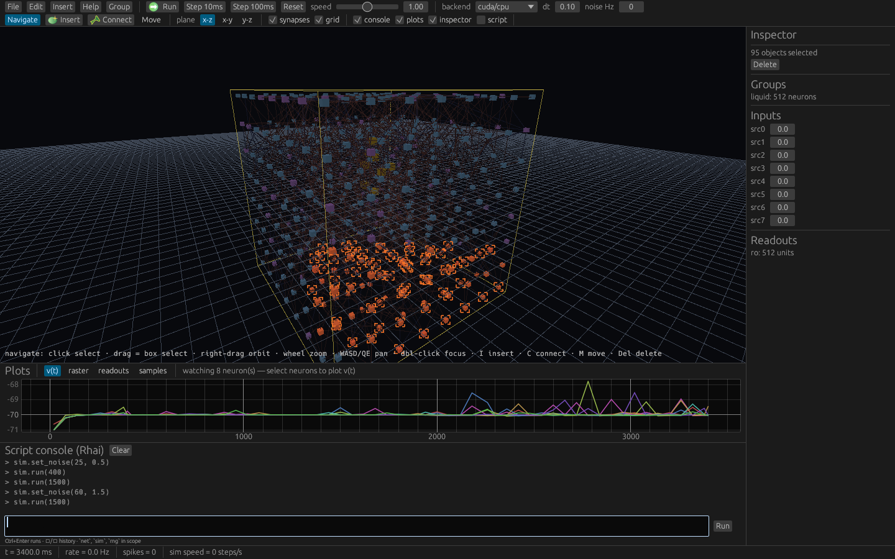

# neuro_edit v2

Rust + CUDA rewrite of the original C++/Qt4 `neuro_edit` (2011–2012): a
spiking-network simulator (Izhikevich neurons, distance-based axonal delays,
exponentially decaying synaptic currents) with Rhai scripting and a 3D egui/wgpu
editor. GPL-3.0, same as the original — the editor reuses the original
toolbar artwork.



## Layout

- `net-format/` — flat network model (neurons, synapses, groups, inputs,
  samples, readouts), `.ne2` binary + `.json` I/O, builders (grids,
  `create_connections`, weight distributions, exc/inh split).
- `sim/` — simulation library + headless `sim` binary. Backends: CPU reference
  and CUDA (`cudarc` + NVRTC, kernels compiled at runtime).
- `editor/` — `editor` binary: egui/wgpu 3D editor with a worker-thread sim,
  GPU picking, plots, Rhai console, and a headless screenshot mode.

## Build

```sh
cargo build --workspace --release
```

CUDA backend needs an NVIDIA toolkit/driver (tested with CUDA 12.9, RTX 3090,
`cudarc` feature `cuda-12090`). Without a GPU use `--cpu` everywhere.

## Headless simulator

```sh
# run a Rhai script (builds its own liquid, trains a readout, prints metrics)
sim --script examples/lsm_hidden.rhai            # CUDA
sim --script examples/lsm_hidden.rhai --cpu      # CPU fallback

# run a network file for N ms
sim --net examples/lsm.ne2 --ms 1000

# eval snippets
sim --eval 'net.create_2d_grid("g", 10, 10, 50.0)' --eval 'print(net.neuron_count())'

# throughput benchmark (N neurons, ~100 out-degree each)
sim --bench 10000  --wscale 0.7 --noise 1
sim --bench 100000 --wscale 0.7 --noise 1

# bitwise-reproducible CUDA runs (fixed-point synaptic ring)
sim --script examples/lsm_hidden.rhai --cuda --int-weights
```

## The LSM example (the milestone use case)

`examples/lsm_hidden.rhai` trains a readout on a liquid driven by 8 seeded
random bit streams. During labelled event windows, fixed *pairs* of sources
become coincident — invisible to single-stream statistics — and the liquid
turns those coincidences into separable spike-count features.

```sh
sim --script examples/lsm_hidden.rhai
```

prints accuracy/AUC for the delta-rule and ridge readouts over a
train/validation/test split, plus three controls (signal off, raw-stream
counts, and a 28-feature pairwise-coincidence baseline), a real permutation
test (500 label shuffles per seed → p-value + null mean/sd), and a
signal-strength sweep. The coincidence baseline solves this task at
AUC 1.0 — plainly better than the liquid's ~0.88 — while the permutation
test shows the liquid's detection is real (p ≈ 0.001–0.003 per seed).
Seeded and reproducible; results in `NOTES-for-data.md`.

## Editor

```sh
editor                                  # empty network, CUDA backend
editor --net examples/lsm.ne2           # open a network
editor --net examples/lsm.ne2 --cpu     # CPU sim backend
editor --script examples/lsm_hidden.rhai   # run a script at startup
```

Controls: right-drag orbit, wheel zoom, WASD pan; left-click select,
shift-click add, box-select by dragging; right-click opens a context menu
on the object under the cursor; `I` insert mode (click to place), `C`
connect mode (click neuron→neuron), `M` move mode, `Del` deletes the
selection; Ctrl+C/X/V copies/cuts/pastes selected subnets as JSON (system
clipboard); toolbar has run/pause/step, speed, dt and noise; bottom console
evaluates Rhai (`sim`, `net`, `rng` globals); panels: inspector, plots
(v(t) traces, spike raster, readout weights, samples), multiline script
editor with scripts saved inside the `.ne2`.

Headless screenshot (no display needed):

```sh
editor --screenshot out.png --net examples/lsm.ne2 --after-ms 500
editor --screenshot big.png --net big.ne2 --no-synapses --width 1920 --height 1080
```

## Server and browser

`server` runs the sim headless and serves the wire protocol over WebSocket;
any number of editors attach to the same run:

```sh
server --bind 127.0.0.1:3090 --data-dir /path/to/data   # headless sim + WS
editor --connect 127.0.0.1:3090                       # remote GUI
```

`--data-dir` sandboxes every path scripts and clients touch (`net.save`/
`net.load`, file reads/writes, Rhai `import`): absolute paths, `..`, and
symlinks resolving outside are refused. Scripts run server-side.

The browser editor is the same egui/wgpu UI compiled to wasm32 and served by
`server --web` — one port carries the page, the wasm bundle and the WebSocket
the page connects back to. WebGPU required (the 3D view uses storage buffers).

```sh
editor/web/build.sh                              # cargo + wasm-bindgen → editor/dist-web
server --bind 127.0.0.1:3090 --data-dir /path/to/data --web editor/dist-web
# open http://127.0.0.1:3090/
```

## Architecture notes

- One `Network` (flat arrays) is shared by the CPU sim, CUDA sim and the
  editor; saving/loading is `.ne2`.
- The editor never runs the sim on the UI thread: a worker owns
  `Network`+`Sim`+Rhai, applies edit/sim commands from a channel, and
  publishes immutable snapshots (geometry, activity, spikes) under an
  `RwLock`. Long scripts run chunked so pause/abort stay responsive.
- Rendering is instanced (one draw for all neuron cubes) + pull-based line
  draws for synapses and overlays; a full-res ID pass gives GPU picking.
- Measured: 97,336 neurons + 1.1 M synapses ≈ 4.4 ms/frame on an RTX 3090
  (see `docs/screenshots/liquid_97k.png`).

The editor does **not** spawn a simulator process — the sim is compiled in
via the `sim` crate and runs on a worker thread; headless and GUI runs share
the same code path.

## Documentation

- `docs/features.md` — full feature documentation (editor UI, headless `sim`,
  file format).
- `docs/scripting.md` — Rhai scripting reference: every `net`/`sim`/readout/
  rng function, with examples.
- `docs/tutorial.md` — step-by-step walkthrough of the LSM example.
- `FEATURE-PARITY.md` — original-editor parity checklist (only items actually
  exercised are ticked).
- `NOTES-for-data.md` — benchmark numbers, experiment results and open items.
